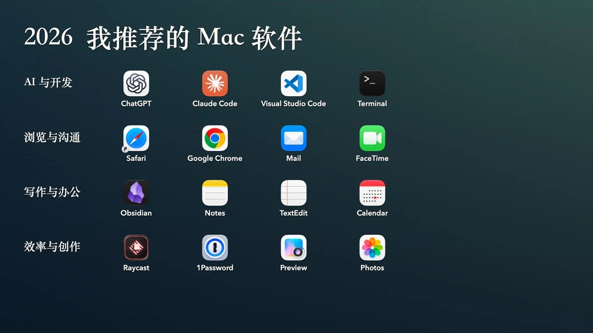

# 乔木软件推荐

把在 Mac 上挑选的好用软件做成可署名分享的海报。在[推荐画廊](https://software.qiaomu.ai/)按软件名、标题或分享名查找作品。每张作品有独立链接和可检索的推荐清单。在[软件目录](https://software.qiaomu.ai/apps)按分类浏览，查看每个软件被多少张公开海报提及。



## 使用

在 Mac 本机安装 [qiaomu-mac-software](https://github.com/joeseesun/qiaomu-mac-software)，对助手说“用我的壁纸和应用图标做一张软件推荐海报”。用户选软件与署名，预览确认后可生成仅链接或公开画廊作品。撤回凭证由本机 Skill 保存。

软件目录以公开海报为统计单位。一张海报里同一个软件即使放在多个分类也只计一次。选了分类后只计该分类的公开海报。目录按软件名称归集，英文名称大小写合并，分享撤回后立即更新。

网站只接收合成图、最终选中的软件名称和分类、标题、分享名和可见范围。后端重新编码图片并去掉源图元数据。仅链接页面可以被转发，且不出现在画廊和站点地图。

## 开发

需要 Node.js 22.16+，数据默认保存在 `./data`。浏览器访问 http://127.0.0.1:3268。

```sh
npm ci
npm test
npm start
```

`POST /api/v1/shares` 接收 JSON `{name,title,visibility,apps:[{name,group}],image}`，其中 image 是 PNG 的 Base64，visibility 可为 `link` 或 `public`。客户端可提供 64 位小写十六进制的随机 `Idempotency-Key` 头，让同一上传安全重试。响应含 share ID、URL 和仅供作者使用的撤回凭证。用 `DELETE /api/v1/shares/:id` 并带 `Authorization: Bearer <凭证>` 撤回。撤回凭证不要进日志或分享链接。站点无需用户账号，公开分享按 IP 限流与总存储配额运行。

## 部署维护

`deploy/` 提供 systemd 与 Nginx 配置。运行时只监听 127.0.0.1。站点用 SQLite，图片、作品元数据和公开软件索引在同一个数据库。启动时从既有公开海报补建索引。将数据目录置于版本目录之外，备份请用 SQLite 在线备份或停服务后备份数据库。

环境变量 `PORT`、`PUBLIC_ORIGIN`、`DATA_DIR` 可覆盖默认配置，`UMAMI_SITE_ID` 可启用 Umami，`TRUST_PROXY=1` 只用于反代覆盖 X-Real-IP 的部署。

举报保存在 SQLite 的 `reports` 表。运营者可按时间查看举报，对确需删除的作品在同一事务删除 `shares` 与 `reports` 中对应 ID，并在维护连接开启 SQLite 外键以级联更新软件索引。

MIT 许可。网站示例中的应用图标归其权利人。Copyright (c) 2026 向阳乔木。
